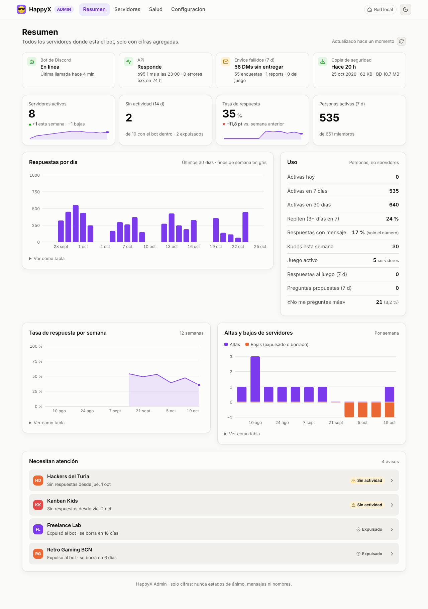

<div align="center">

<a href="https://github.com/happyx-app/HappyX"></a>

# HappyX.Admin

The admin dashboard for whoever runs a **[HappyX](https://github.com/happyx-app/HappyX)** instance:
how many servers use it, how much they answer and whether the service is healthy.

[](https://github.com/happyx-app/HappyX.Admin/actions/workflows/ci.yml)
[](package.json)
[](#security)
[](https://github.com/orgs/happyx-app/packages)

[HappyX](https://github.com/happyx-app/HappyX) ·
[Api](https://github.com/happyx-app/HappyX.Api) ·
[Bot](https://github.com/happyx-app/HappyX.Bot) ·
[Web](https://github.com/happyx-app/HappyX.Web) ·
**Admin** ·
[Bruno](https://github.com/happyx-app/HappyX.Bruno)

</div>

> [!TIP]
> New here? Start with the [main HappyX README](https://github.com/happyx-app/HappyX): what HappyX
> does, screenshots, the architecture and how to self-host the whole stack.



The public [dashboard](https://github.com/happyx-app/HappyX.Web) shows each server's admins their
own server. This one is for the person who hosts HappyX and sees **every server, but only as
counts**: never a mood, a message, a member's name or anything else members wrote.

- **Overview**: the bot, the API, failed DMs and the latest backup at a glance; active and idle
  servers, the response rate, active people, answers per day, the weekly response rate, servers
  joining and leaving, and the servers that need a look (idle, about to be deleted, losing DMs).
- **Servers**: every server with its members, active people, response rate and state, to
  filter, search and sort; each one opens a page with its weekly answers and its settings.
- **Health**: API latency per hour, failed DMs per day, the database and the latest backups.
- **Settings**: how the servers have set HappyX up (language, timezone, survey hour,
  anonymity, report, roles, extras), to choose good defaults.

TypeScript without a framework, built with Vite, with the same look and hand-drawn SVG charts as
HappyX.Web. Served by nginx, which forwards `/api/admin/*` to the API's admin port and adds the
admin key itself, so the browser never holds it.

## Security

The dashboard is meant to be opened **only from your local network**:

- The API serves it on a port of its own (`ADMIN_ADDR`, `:8081` by default) that is never published:
  only this container reaches it, over the stack's internal network.
- That port takes its own key (`ADMIN_KEY_HASH` in the API). The bot's keys and dashboard sessions
  don't work there, and the admin key works nowhere else.
- nginx answers only private addresses (`10.0.0.0/8`, `172.16.0.0/12`, `192.168.0.0/16`,
  loopback and IPv6 local ranges) and only `GET` requests to the API.
- **Don't publish it to the internet**, behind a reverse proxy, a tunnel or a port forward. If you
  need it away from home, use a VPN into your network.

## Run it

It's part of the stack in [HappyX](https://github.com/happyx-app/HappyX) (`deploy/stack.yml`). Make
a key, give its hash to the API and the key to this container:

```sh
KEY=$(openssl rand -hex 32); echo "ADMIN_API_KEY=$KEY"; echo -n "$KEY" | sha256sum   # → ADMIN_KEY_HASH
```

| Variable | Purpose |
| --- | --- |
| `ADMIN_API_KEY` | The admin key. Without it the dashboard only shows how to set it up |
| `API_URL` | The API's admin port on the internal network, default `http://api:8081` |

The image listens on port 8080 (`ghcr.io/happyx-app/happyx-admin`, amd64 and arm64).

The response rate needs the bot to report how many people each survey went to, which it does from
HappyX.Bot with this feature on; older surveys show no rate. API latency and the bot's last call
are kept in the API's memory and start over when it restarts. To list backups, mount the backups
folder into the API read-only and set `BACKUP_DIR`.

## Development

```sh
npm install
API_URL=http://localhost:8081 ADMIN_API_KEY=<key> npm run dev   # http://localhost:8090
npm test
npm run build
```

Vite forwards `/api/admin` to `API_URL` with the key, like nginx does in production.

## Layout

```
src/main.ts        shell: top bar, theme, routes in the URL fragment, loading and errors
src/route.ts       #/, #/servers, #/servers/<id>, #/health, #/settings
src/api.ts         the admin API's types and calls
src/pages/         one file per page
src/charts.ts      bar, line and joins/leaves charts, sparklines, table views, distributions
src/format.ts      numbers, dates and the rules the pages share (rates, what needs attention)
src/ui.ts          cards, pills, the health strip
nginx.conf.template  local network only, adds the admin key, 404 for anything else
```

## How it's built

HappyX is developed with AI assistance. Every change is reviewed and approved by the maintainer before it's merged.

## License

[AGPL-3.0](LICENSE). Versions published before 30 October 2026 (up to commit [`a0e1182`](https://github.com/happyx-app/HappyX.Admin/tree/a0e1182dc9f52fa04913a08632eacb77cab2e63c)) remain available under the MIT License.
